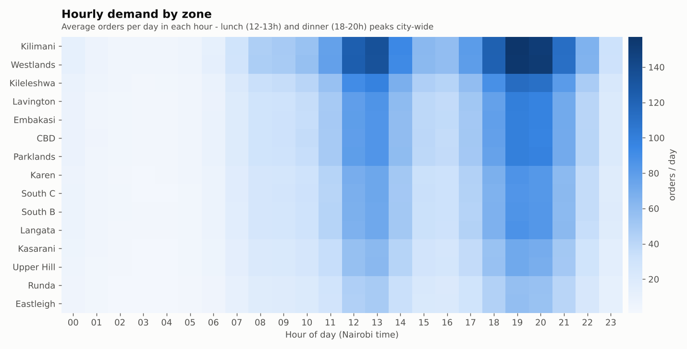
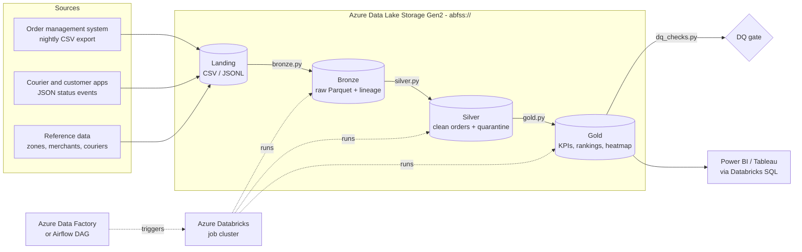
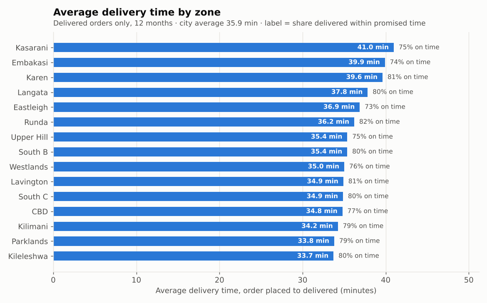
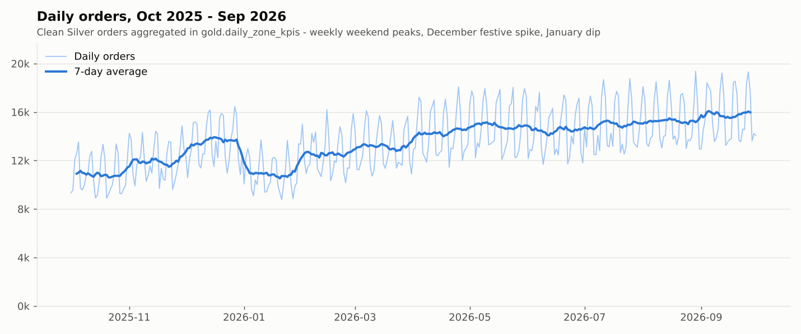

# Nairobi Delivery Orders: PySpark Medallion Pipeline on Azure

**A config-driven PySpark pipeline that takes 5 million messy food and grocery delivery orders through Bronze, Silver and Gold layers into dashboard-ready KPIs. It quarantines bad records, resolves late-arriving events and runs a reconciliation gate. The same code runs on a laptop or on Azure Databricks over ADLS Gen2.**

[](https://github.com/JoMatata/spark-delivery-pipeline-azure/actions/workflows/ci.yml)
  

> **All data is synthetic.** `src/generate_data.py` creates it from a fixed seed. It models Nairobi neighbourhoods, meal-time peaks, traffic, the rainy seasons and festive demand. No real customer, merchant or courier data is used.



---

## Architecture



| Layer | What happens | Storage |
|---|---|---|
| **Landing** | Raw drops: 12 monthly order CSVs, JSON Lines status events, dimension CSVs | `landing/` |
| **Bronze** | Reads with **explicit schemas** (no inference). Every order column stays a string so nothing is lost. Adds lineage columns `_source_file`, `_ingested_at`, `_batch_id` and `_ingest_date` | Parquet, partitioned by `_ingest_date` |
| **Silver** | ANSI-safe type casting, **window-function dedupe**, late-event resolution, zone standardisation, **broadcast joins** to dims, native-function haversine distance, delivery time, and 12 **DQ rules** that route failures to a quarantine table | Parquet, partitioned by `order_date` |
| **Gold** | `daily_zone_kpis`, `courier_performance`, `merchant_ranking`, `hourly_demand` | Parquet, partitioned by `order_date` / `order_month` |
| **DQ gate** | 11 reconciliation and invariant checks. Any failure fails the run (and the DAG) | `reports/dq_report.json` |

## Tech stack

| Area | Tools |
|---|---|
| Processing | PySpark 4.0 (Spark SQL, window functions, AQE, broadcast joins) |
| Storage | Parquet on local disk or **ADLS Gen2** (`abfss://`), partitioned by date |
| Cloud compute | **Azure Databricks**: multi-task job on an autoscaling job cluster, deployed as a Python wheel |
| Orchestration | **Azure Data Factory** (copy to landing, trigger the job, poll, fail on error) or **Apache Airflow** (`bronze >> silver >> gold >> dq_checks`) |
| Config | YAML profiles (`local` / `azure`) with `${ENV:-default}` expansion |
| Testing / CI | pytest with a local SparkSession; GitHub Actions (Java 17 + Python 3.12): tests, a 20k-row smoke run, wheel build |
| Data generation / charts | NumPy, pandas, Matplotlib |

## Data quality approach

Bad data is never dropped silently. It is either fixed by a rule you can explain or quarantined with the reason attached.

| Problem injected by the generator | How the pipeline handles it | Rows at 5M scale |
|---|---|---:|
| Duplicate exports and stale `IN_TRANSIT` snapshots | `row_number()` over `order_id` ordered by `updated_at DESC, _ingested_at DESC` keeps the latest version | 73,779 removed |
| Orders exported mid-delivery (`IN_TRANSIT`) | The latest terminal **status event** per order sets the final status and delivery time (`status_source = late_event`) | 139,020 resolved |
| At-least-once event delivery | `dropDuplicates(["event_id"])` | 25,922 dropped |
| Truncated or corrupt JSON lines | `PERMISSIVE` mode plus `_corrupt_record`, sent to event quarantine | 138 |
| `"1,250.00"` amounts, malformed timestamps | `try_cast` / `try_to_timestamp`: bad values become NULL instead of failing an ANSI-mode job, then a DQ rule catches them | – |
| `" westlands "`, `WESTLANDS`, `south-b`, `Nairobi CBD` | Normalised key plus config-driven alias map, joined to the zone dimension | – |
| Out-of-bounds, `(0,0)` or swapped lat/lon | `coordinates_out_of_bounds` (Nairobi bounding box from config) | 15,215 |
| Null or negative basket | `invalid_basket_value` | 14,802 |
| Null or orphan merchant / courier | `missing_merchant_id`, `orphan_merchant_id`, `orphan_courier_id` (a NULL courier on an order cancelled before assignment is valid) | 7,631 / 0 / 5,077 |
| Delivered before ordered (device clock skew) | `delivered_before_ordered` | 4,562 |
| Location outside the delivery area | `unknown_zone` | 2,452 |

All rules are evaluated **in a single pass** into an array column `dq_failures`. A row with an empty array goes to Silver. Any other row goes to `silver/quarantine/orders` with every rule it broke, so one bad record shows all of its problems at once. At 5M orders, **1.09%** were quarantined, against a 5% threshold that fails the run.

The **DQ gate** then checks that Gold reconciles with Silver: order counts and GMV match exactly, `order_id` is unique, percentages fall in 0–100, delivery times are positive, the heatmap covers every zone and merchant totals tie out.

## Performance optimisations

- **Explicit schemas** everywhere. No inference pass over 1.2 GB of CSV, and types can't drift.
- **Broadcast hash joins** for every dimension (zones, merchants, couriers). The 5M-row fact table is never shuffled for a lookup. The latest-event table is small enough to be broadcast too.
- **Window dedupe that the optimiser can prune**: Spark's `WindowGroupLimit` keeps only the top row per `order_id` *before* the shuffle (visible in the physical plan).
- **Native column functions instead of UDFs.** Haversine is built from `sin/cos/asin/radians`, so it runs in the JVM under whole-stage codegen. Measured on 4.9M rows: native **1.41 s**, pandas UDF **6.19 s** (4.4× slower), row-at-a-time Python UDF **17.47 s** (12.4× slower).
- **Caching only where data is reused**: the validated Silver frame (two writes plus metrics) and the Gold input (four aggregates), both with `MEMORY_AND_DISK` and unpersisted afterwards.
- **`repartition(order_date)` before `partitionBy(order_date)`** gives one file per date partition instead of `tasks × dates` small files.
- **Column pruning**: Gold reads only the 18 Silver columns it needs from Parquet.
- **AQE on** (partition coalescing, skew-join handling), **dynamic partition overwrite** for idempotent re-runs, and Snappy Parquet: 1.26 GB of raw CSV/JSON becomes 374 MB in Bronze.

## Benchmark: 5,000,000 orders, actually run

This ran end to end in a 2-vCPU / 7.8 GB container, Spark 4.0.1 in local mode with a 5 GB driver. Full details are in [`docs/benchmark.md`](docs/benchmark.md).

| Stage | Seconds | Output |
|---|---:|---|
| Generate synthetic data (NumPy, not Spark) | 152.7 | 5,073,779 raw order rows, 1,311,063 JSON events |
| Bronze | 115.0 | Parquet + lineage |
| Silver | 388.0 | 4,945,463 clean orders, 54,537 quarantined |
| Gold | 107.0 | 4 tables (5,475 / 30,000 / 24,000 / 2,520 rows) |
| DQ gate | 26.8 | 11 / 11 checks passed |
| **Pipeline total** | **636.8 (≈10.6 min)** | ≈7,850 orders/s on 2 cores |

## Key insights (from the Gold tables)

All figures come from the 5M-order run over Oct 2025 – Sep 2026, synthetic data, 4,945,463 clean orders.

- **KES 7.90 bn GMV** from 4.69M delivered orders. The average basket is **KES 1,685**, the city-wide average delivery time is **35.9 min**, **78.1%** of orders arrive on time and **4.93%** are cancelled.
- **Demand grew 40.7%**, from 334,641 orders in Oct 2025 to 470,784 in Sep 2026. December ran **+15.4%** on November and January fell **18.3%**, the "Njaanuary" slump after the festive season.
- **19:00 is the busiest hour** (≈1,426 orders/day city-wide), followed by a 12:00–13:00 lunch peak. **Saturday demand is 37.7% higher than Tuesday's.**
- **The outer zones are slowest.** Kasarani (41.0 min), Embakasi (39.9) and Karen (39.6) compare with 33.7 min in Kileleshwa. Kasarani also has the highest cancellation rate (6.6%).
- **Being slow and being late are different things.** Karen's deliveries are long but **81%** arrive on time because its promised windows are longer. Eastleigh (73.2%) and Embakasi (74.0%) miss their promises most often, so they are the place to fix rider supply or the ETA model.
- **The evening rush costs 6 minutes.** An 18:00 order takes 39.3 min on average against 33.3 min at 15:00. The April–May long rains add about 2.2 min per order (37.5 vs 35.3 min in dry months).
- **Vehicle mix matters**: motorbikes are on time 83.5% of the time, cars 73.2% and bicycles 54.9%. Bicycles should be limited to short-radius orders.
- **Merchant concentration**: the top 10% of merchants generate **41.4% of GMV**. Restaurants account for 46.8% of GMV and grocery 40.1%.
- From Silver, **cash orders are cancelled at 9.5%**, more than double M-Pesa (4.4%) and card (4.4%).

| Average delivery time by zone | Daily orders trend |
|---|---|
|  |  |

## Run it locally

You need Python 3.10–3.13 and Java 17 or 21.

```bash
git clone https://github.com/JoMatata/spark-delivery-pipeline-azure.git
cd spark-delivery-pipeline-azure
pip install -r requirements.txt

./run_all.sh                    # 50k orders: generate -> bronze -> silver -> gold -> dq -> charts
ROWS=5000000 ./run_all.sh       # the full 5M-order run (~13 min on 2 cores incl. generation)

make test                       # 24 tests: dedupe, DQ rules, late events, haversine, KPIs, end-to-end
make benchmark                  # regenerate docs/benchmark.md
PYTHONPATH=src python -m pipeline.run --stage silver --profile local   # run a single stage
```

Outputs go to `data/lake/{bronze,silver,gold}` and `data/reports/dq_report.json`. The `data/` folder is gitignored.

## Deploy on Azure

1. **Storage**: create an ADLS Gen2 account (hierarchical namespace on) with containers `landing` and `lakehouse`. Set `AZURE_STORAGE_ACCOUNT`; the `azure` profile in [`conf/config.yaml`](conf/config.yaml) builds the `abfss://…dfs.core.windows.net` paths from it.
2. **Access**: on Unity Catalog, create an External Location on the containers and grant it to the job's identity. Without UC, put a service principal's client ID, secret and tenant in a Key Vault-backed secret scope `kv-delivery`. The job's `spark_conf` already references `{{secrets/kv-delivery/...}}`.
3. **Package**: run `make wheel`, then upload `dist/nairobi_delivery_pipeline-1.0.0-py3-none-any.whl` and `conf/config.yaml` to `/Volumes/delivery/artifacts/…`.
4. **Databricks job**: `databricks jobs create --json @azure/databricks_job.json`. This creates four chained `python_wheel_task`s (`bronze → silver → gold → dq_checks`) on an autoscaling (2–6 workers) Photon job cluster that uses spot instances with on-demand fallback.
5. **Orchestrate**, either way:
   - **ADF**: import [`azure/adf_pipeline.json`](azure/adf_pipeline.json). It copies the OMS export (SFTP) and the app status-event files (Blob) to landing, calls `jobs/run-now` with the factory's **managed identity**, polls `runs/get` in an `Until` loop and raises a `Fail` activity if the result isn't `SUCCESS`. Add the factory's managed identity to the workspace and set `databricksJobId`. [`azure/adf_trigger.json`](azure/adf_trigger.json) schedules it daily at 02:15 EAT.
   - **Airflow**: deploy [`dags/delivery_pipeline_dag.py`](dags/delivery_pipeline_dag.py) with `DELIVERY_PIPELINE_MODE=databricks`. Each stage then runs as a `DatabricksSubmitRunOperator` task using the same wheel entry point. With `local`, it runs `python -m pipeline.run` on the worker.
6. **BI**: create Databricks SQL (or Synapse serverless) external tables over `gold/*` and connect Power BI or Tableau.

## Project structure

```
spark-delivery-pipeline-azure/
├── src/
│   ├── generate_data.py          # seeded synthetic data with injected dirt (CSV + JSONL)
│   └── pipeline/
│       ├── config.py             # YAML profiles + env expansion, local / abfss paths
│       ├── spark_session.py      # SparkSession from config
│       ├── schemas.py            # explicit StructType schemas
│       ├── bronze.py             # raw ingest + lineage columns
│       ├── silver.py             # cast, dedupe, late events, conform, haversine, DQ + quarantine
│       ├── gold.py               # daily zone KPIs, courier perf, merchant ranking, hourly demand
│       ├── dq_checks.py          # reconciliation gate -> dq_report.json
│       └── run.py                # CLI / wheel entry point: --stage bronze|silver|gold|dq|all
├── conf/config.yaml              # local + azure profiles, DQ thresholds, zone aliases
├── azure/
│   ├── databricks_job.json       # 4-task Databricks job (wheel tasks, job cluster, secrets)
│   ├── adf_pipeline.json         # ADF: copy -> run-now -> poll -> fail-on-error
│   └── adf_trigger.json          # daily schedule trigger
├── dags/delivery_pipeline_dag.py # Airflow: bronze >> silver >> gold >> dq_checks
├── scripts/
│   ├── benchmark.py              # timed 5M run + UDF vs native comparison -> docs/benchmark.md
│   └── make_report.py            # charts + insights.json from gold tables
├── tests/                        # pytest + local SparkSession (24 tests)
├── docs/                         # benchmark.md, benchmark_results.json, insights.json, images/
├── .github/workflows/ci.yml
├── Makefile · run_all.sh · pyproject.toml · requirements.txt · LICENSE
```

## Skills demonstrated

- **Big-data engineering with PySpark**: medallion architecture, explicit schemas, window functions, broadcast joins, AQE, caching strategy, partitioned Parquet, reading physical plans
- **Data quality engineering**: rule-based validation, quarantine with reasons, idempotent dedupe, late-arriving data, cross-layer reconciliation gates
- **Azure data platform**: ADLS Gen2 (`abfss://`), Azure Databricks jobs and job clusters, secret scopes and managed identity, Azure Data Factory orchestration
- **Orchestration and DevOps**: Airflow DAG design, wheel packaging, GitHub Actions CI, config-driven multi-environment deployment
- **Performance measurement**: an end-to-end benchmark at 5M rows and an evidence-based comparison of native functions vs UDFs
- **Analytics**: KPI design (GMV, on-time %, cancellation rate, p90), turning Gold tables into business findings and clear charts

## Author

**Joan Matata**, data professional based in Nairobi, Kenya
GitHub: [@JoMatata](https://github.com/JoMatata)

Licensed under the [MIT License](LICENSE).
